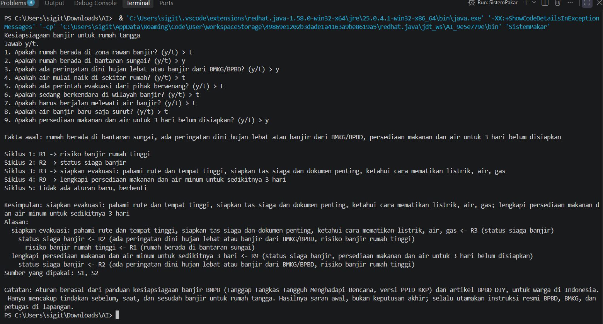
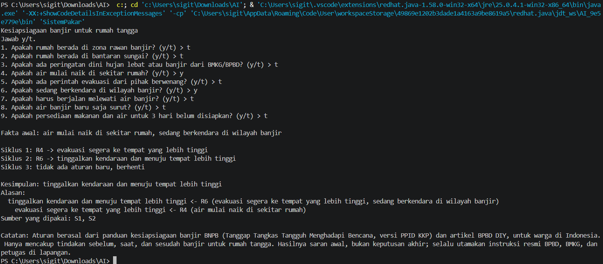
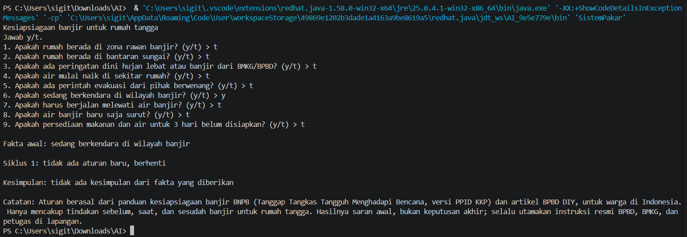

# AI-Tugas-F1D02510018
# Tugas 5 AI: Sistem Pakar Kesiapsiagaan Banjir (alternatif)

**Nama:** SIGIT DEZAN ZULPI  **NIM:** F1D02510134

Topik: tindakan kesiapsiagaan banjir untuk rumah tangga. Bahasa: Java 16+ (diuji OpenJDK 21).
Jalankan: `java SistemPakar.java` (memakai `kb_banjir.json`). Metode: Forward Chaining; mesin dan pembaca JSON ditulis sendiri.

## Sumber
- S1: Siaga Bencana Banjir (kutipan buku *Tanggap Tangkas Tangguh Menghadapi Bencana*, BNPB), PPID KKP. https://ppid.kkp.go.id/media/uploads/document_information_public/4._Siaga_Bencana_Banjir.pdf , diakses 11 Nov 2026
- S2: Antisipasi Dampak Risiko Bencana saat Musim Hujan, BPBD DIY. https://bpbd.jogjaprov.go.id/berita/antisipasi-dampak-risiko-bencana-saat-musim-hujan , diakses 11 Nov 2026

## Aturan
| Aturan | IF | THEN | Sumber |
|---|---|---|---|
| R1 | rumah di zona rawan banjir OR di bantaran sungai | risiko banjir rumah tinggi | S1 |
| R2 | ada peringatan dini AND risiko banjir rumah tinggi | status siaga banjir | S1, S2 |
| R3 | status siaga banjir | siapkan evakuasi (rute, tas siaga, dokumen, cara matikan listrik/air/gas) | S1, S2 |
| R4 | air mulai naik OR ada perintah evakuasi | evakuasi segera ke tempat lebih tinggi | S1, S2 |
| R5 | evakuasi segera AND ada perintah evakuasi | matikan listrik, cabut peralatan listrik | S1 |
| R6 | evakuasi segera AND sedang berkendara di wilayah banjir | tinggalkan kendaraan, menuju tempat lebih tinggi | S1 |
| R7 | evakuasi segera AND harus berjalan melewati air | berjalan di pijakan tetap, cek dengan tongkat, hindari arus | S1 |
| R8 | air banjir baru surut | hindari air dan area bekas banjir | S1 |
| R9 | status siaga banjir AND persediaan 3 hari belum disiapkan | lengkapi makanan dan air 3 hari | S1 |

Rantai: R1 -> R2 -> R3/R9 dan R4 -> R5/R6/R7. Kesimpulan akhir = fakta turunan yang tidak dipakai aturan lain pada proses itu.

## Kasus uji
| # | Jawaban "ya" | Hasil |
|---|---|---|
| 1 | bantaran sungai, peringatan dini, persediaan belum | siapkan evakuasi; lengkapi persediaan 3 hari |
| 2 | air mulai naik, sedang berkendara | tinggalkan kendaraan, menuju tempat lebih tinggi |
| 3 | sedang berkendara saja | tidak ada kesimpulan |
| 4 | air baru surut | hindari air dan area bekas banjir |

## Batas keberlakuan
Pengetahuan berasal dari panduan BNPB dan BPBD untuk warga Indonesia, hanya untuk tindakan rumah tangga sebelum, saat, dan sesudah banjir. Tidak memperhitungkan tinggi air, debit sungai, atau kondisi khusus (banjir bandang, lansia, anak). Hasilnya saran awal, bukan keputusan akhir; utamakan instruksi BPBD, BMKG, dan petugas. Program menampilkan catatan ini.

## Penggunaan alat bantu AI
Claude dipakai untuk mencari sumber dan menyusun draf kode; saya telah membaca sumber, memverifikasi aturan, dan dapat menjelaskan kode.
